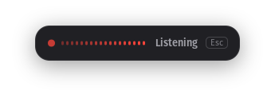
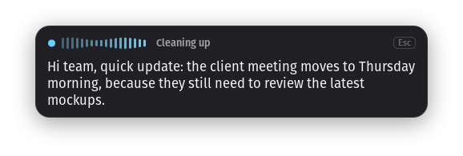

# live-dictate

[](https://github.com/spectaA/live-dictate/actions/workflows/ci.yml)
[](https://github.com/spectaA/live-dictate/releases/latest)
[](LICENSE)

Push-to-talk dictation for Linux X11 desktops. Hold a key, speak, release: your words are transcribed live, cleaned up by a small language model and pasted into whatever text field has the focus.

<p align="center">
  
</p>

## Features

- **Live transcript** while you speak, streamed by OpenAI [`gpt-live-transcribe`](https://developers.openai.com/api/docs/guides/realtime-transcription).
- **Cleanup pass** that removes filler words, stutters and false starts, and fixes punctuation, without rephrasing you.
- **Pastes anywhere**: browsers, editors, chat apps and terminals (`Ctrl+Shift+V` is used in terminals). Your clipboard is restored afterwards.
- **Unobtrusive overlay** on the monitor under your pointer, with a live audio level meter. It never steals the focus.
- **Fast by design**: audio streams while you speak, so the transcript is final about half a second after you release the key.
- **One-command updates** from GitHub releases, with checksum verification.

## Requirements

- An Ubuntu 22.04 based distribution (Ubuntu, Pop!_OS, Linux Mint 21, ...) running an **X11** session. Wayland is not supported.
- An [OpenAI API key](https://platform.openai.com/api-keys).

## Installation

Download the latest `.deb` from the [releases page](https://github.com/spectaA/live-dictate/releases/latest), then:

```bash
sudo apt install ./live-dictate_*_amd64.deb
live-dictate setup
```

The setup window asks for your OpenAI API key, checks it, and lets you pick your language and hotkey. The key is stored in your GNOME keyring, never in a file.

live-dictate then starts by itself at every login. If you skip `live-dictate setup`, the same window opens at your next login. You can reopen it at any time from the applications menu (**live-dictate**) or with `live-dictate setup`.

## Usage

| Action | Key |
|---|---|
| Dictate | Hold **Right Ctrl**, speak, release |
| Cancel the current dictation | **Esc** |

The overlay shows what is happening:

| Listening | Cleaning up |
|---|---|
|  |  |

Commands:

```bash
live-dictate setup             # change the API key, language or hotkey
live-dictate check --api       # diagnose tools, key, microphone and the cleanup call
live-dictate run --dry-run     # print the text instead of pasting it
live-dictate run --no-cleanup  # paste the raw transcript
live-dictate -v run            # debug logs (never include your API key)
live-dictate update --check    # look for a new release
live-dictate update            # install the latest release
```

## Configuration

`live-dictate setup` covers the common settings. Everything else lives in `~/.config/live-dictate/config.toml`, where every key is optional.

```toml
hotkey = "<ctrl_r>"                     # pynput syntax, e.g. "<ctrl>+<alt>+d"
mode = "hold"                           # "hold" (push-to-talk) or "toggle"
languages = ["en"]                      # defaults to your system language; [] auto-detects
transcription_model = "gpt-live-transcribe"
transcription_delay = "low"             # minimal, low, medium, high, xhigh
transcription_prompt = ""               # context, e.g. "Software engineering stand-up"
keywords = ["Kubernetes", "PostgreSQL"] # names and jargon to spell correctly
cleanup_enabled = true
cleanup_model = "gpt-6-luna"
cleanup_service_tier = "fast"           # "default" is cheaper and slower
cleanup_timeout_s = 3.0                 # the raw transcript is pasted on timeout
cleanup_min_words = 5                   # shorter dictations skip the cleanup
min_audio_ms = 300                      # ignore accidental taps
paste_restore_delay_s = 0.5
terminal_classes = ["gnome-terminal-server", "kitty", "alacritty"]
```

Windows listed in `terminal_classes` receive `Ctrl+Shift+V`. Run `xprop WM_CLASS` and click a window to find its class.

Restart the service after editing the file: `systemctl --user restart live-dictate`.

## Privacy and cost

- Audio is streamed to OpenAI for transcription, and the transcript is sent to OpenAI for cleanup. Cleanup requests are made with `store: false`. Review [OpenAI's data policies](https://openai.com/policies/) before dictating sensitive content.
- Nothing is written to disk. Dictated text only appears in logs with `-v`.
- At OpenAI's current prices, transcription costs about $0.017 per minute of audio. Cleanup costs a fraction of a cent per dictation.

## Troubleshooting

- **Nothing happens when I hold the key**: run `live-dictate check`, then `journalctl --user -u live-dictate -n 50`.
- **"already running"**: only one instance can run. Run `systemctl --user stop live-dictate` before `live-dictate run`.
- **Text is not pasted in one application**: add its class to `terminal_classes` if it is a terminal, or open an issue.

## Development

live-dictate needs the distribution's GTK bindings, so the virtual environment must see system packages:

```bash
sudo apt install python3-gi python3-gi-cairo gir1.2-gtk-3.0 pulseaudio-utils xdotool xclip x11-utils
uv venv --system-site-packages --python /usr/bin/python3
uv sync
uv run live-dictate run --dry-run
```

See [CONTRIBUTING.md](CONTRIBUTING.md) for checks and the release process, and [docs/architecture.md](docs/architecture.md) for how it works.

## License

[MIT](LICENSE)
